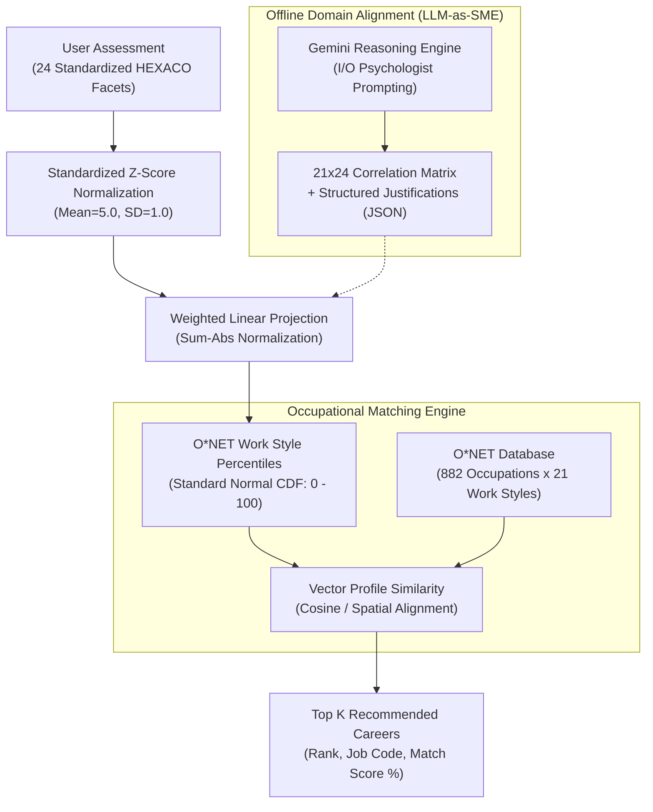
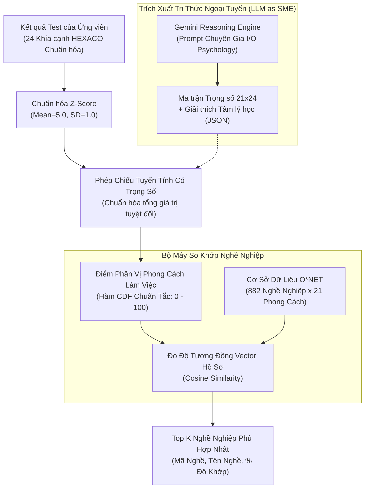

# 🧭 HEXACO-O*NET Career Recommender System
### Cross-Domain Psychometric Alignment via LLM-as-a-Subject-Matter-Expert (SME)

---

## 🌐 English Version

An end-to-end AI-driven career recommendation pipeline that bridges **Personality Psychology (HEXACO 24-Facet Model)** with the **World of Work (O*NET 21 Work Styles Taxonomy)**.

Instead of relying on costly and time-consuming expert Delphi consensus panels, this project leverages **Large Language Models (Gemini 3.8 Flash) as Subject Matter Experts (SMEs)** in Industrial-Organizational (I/O) Psychology to construct an interpretable, mathematically grounded cross-domain correlation matrix.

### 📌 System Architecture



### 🧠 Scientific Methodology & Mathematical Foundations

#### 1. Normative HEXACO Scoring
Official standardized HEXACO assessments (e.g., University of Calgary) report facet scores normalized to a population distribution with:
$$\mu = 5.00, \quad \sigma = 1.00$$

We calculate the candidate's normalized deviation ($Z\text{-score}$) for each facet $i \in \{1, \dots, 24\}$:
$$Z_i = \frac{X_i - 5.0}{1.0} = X_i - 5.0$$

#### 2. Weighted Psychometric Projection (LLM-as-an-Expert)
Let $\mathbf{W} \in [-1.0, +1.0]^{21 \times 24}$ be the domain-alignment matrix generated by Gemini. For each O*NET Work Style $j$:
$$Z_{\text{workstyle}, j} = \frac{\sum_{i=1}^{24} W_{j, i} \cdot Z_i}{\sum_{i=1}^{24} |W_{j, i}|}$$

*Dividing by the absolute sum of weights $\sum |W_{j, i}|$ prevents variance inflation and preserves standardized bounds.*

#### 3. Percentile Calibration via Cumulative Distribution Function
To match the empirical O*NET scale ($0 - 100$), the predicted work style $Z\text{-score}$ is mapped through the Standard Normal Cumulative Distribution Function ($\Phi$):
$$\text{Score}_{\text{O*NET}, j} = \Phi\left(Z_{\text{workstyle}, j}\right) \times 100 \in [0, 100]$$

* **$Z = 0.0$** $\rightarrow$ **$50.0\%$** (Population Median)
* **$Z = +1.0$** $\rightarrow$ **$84.1\%$** (Superior Aptitude)
* **$Z = -1.0$** $\rightarrow$ **$15.9\%$** (Low Affinity)

#### 4. Multi-Criteria Occupational Profile Matching
Candidate vector $\mathbf{u} \in \mathbb{R}^{21}$ is matched against occupational benchmark vectors $\mathbf{v}_k \in \mathbb{R}^{21}$ from the US Department of Labor O*NET database via Cosine Similarity:
$$\text{Match Score}(\mathbf{u}, \mathbf{v}_k) = \frac{\mathbf{u} \cdot \mathbf{v}_k}{\|\mathbf{u}\|_2 \|\mathbf{v}_k\|_2} \times 100\%$$

To ensure realistic, practical guidance, the system supports multi-criteria constraints:
* **Educational Feasibility (Job Zones 1–5):** Filters careers based on required education level, ranging from high school (Zone 1) and vocational training (Zone 3) to Bachelor's (Zone 4) and Graduate/Medical degrees (Zone 5).
* **Industry Focus (22 Job Families):** Allows targeting specific career families (e.g., *Computer & Mathematical*, *Business & Financial*, *Healthcare*, *Management*).

### 🔬 Dual-Engine Alignment Comparison

| Dimension | Engine A: LLM-as-an-Expert (Gemini) | Engine B: Dense Semantic Embedding (SBERT) |
| :--- | :--- | :--- |
| **Model** | Google Gemini 3.8 Flash | `all-mpnet-base-v2` (`sentence-transformers`) |
| **Mechanism** | Cognitive reasoning based on formal I/O definitions | Dense semantic vector cosine similarity |
| **Negative Correlates** | ✅ Captures inverse drivers (e.g., *Anxiety $\rightarrow$ -0.8 Stress Tolerance*) | ❌ Struggles with psychological negations (only captures lexical proximity) |
| **Explainability** | ✅ Generates step-by-step psychological justifications | ❌ Black-box vector distance |
| **Runtime Efficiency** | Offline JSON distillation (Instant runtime inference) | Requires local tensor embeddings |

### 📂 Project Structure

```text
Job_suggest_using_hexaco_scores/
├── data/
│   ├── onet_workstyles.csv          # Curated dataset of 882 O*NET occupations
│   └── gemini_mapping_weights.json  # 21x24 alignment weights & psychological reasoning
├── src/
│   ├── vision_parser.py             # Gemini Vision OCR & File Dialog parser
│   ├── generate_weights_gemini.py   # Checkpointed script calling Gemini API
│   ├── mapping_LLM.py               # Z-score & Norm CDF calculation engine
│   ├── mapping_hexaco_to_workstyles.py # Alternative SBERT embedding pipeline
│   └── compare.py                   # Occupational similarity matcher
├── app.py                           # Streamlit interactive Web Application
├── main.py                          # Unified CLI entry point
├── requirements.txt                 # Clean minimal dependencies
├── .gitignore                       # Secures .env secrets and cache
└── README.md                        # Bilingual documentation
```

### 🚀 Quickstart Guide

#### 1. Installation
```bash
git clone https://github.com/your-username/Job_suggest_using_hexaco_scores.git
cd Job_suggest_using_hexaco_scores
pip install -r requirements.txt
```

#### 2. Run Career Recommender
```bash
# Option A: Launch Interactive Web App (Recommended)
streamlit run app.py

# Option B: Run Command Line Interface (CLI)
python main.py
```

#### 3. Sample output
```text
============================================================================
      HEXACO-O*NET CAREER RECOMMENDER SYSTEM
      (Psychometric Cross-Domain Alignment via LLM-as-an-Expert)
============================================================================

[+] CANDIDATE WORK STYLE PROFILE (O*NET 0-100 NORM CDF SCALE):
----------------------------------------------------------------------------
  * Top Signature Strengths:
     • Cautiousness              : 60.0/100
     • Optimism                  : 47.5/100
     • Self Confidence           : 47.1/100

[*] TOP 10 RECOMMENDED OCCUPATIONS:
----------------------------------------------------------------------------
  Rank   O*NET Code     Occupation Title                           Match Score
----------------------------------------------------------------------------
  #1     29-1243.00     Pediatric Surgeons                         93.78%
  #2     47-1011.00     First-Line Supervisors of Construction...  93.78%
  #3     29-1141.04     Clinical Nurse Specialists                 93.63%
  #4     51-1011.00     First-Line Supervisors of Production...    93.56%
  #5     13-1082.00     Project Management Specialists             93.53%
  #6     53-1043.00     First-Line Supervisors of Material-M...    93.48%
  #7     11-9021.00     Construction Managers                      93.36%
  #8     39-2011.00     Animal Trainers                            93.33%
  #9     49-1011.00     First-Line Supervisors of Mechanics...     93.33%
  #10    11-9051.00     Food Service Managers                      93.11%
============================================================================
```

#### 4. (Optional) Re-generate Domain Weights via Gemini API
The repository comes pre-packaged with distilled weights in `data/gemini_mapping_weights.json`. To re-generate using your own Gemini API key:
1. Create a `.env` file in the project root:
   ```env
   GEMINI_API_KEY=your_actual_api_key_here
   ```
2. Run the fault-tolerant generator (includes auto-resumption & exponential backoff):
   ```bash
   python src/generate_weights_gemini.py
   ```

---

## 🇻🇳 Phiên Bản Tiếng Việt

Hệ thống gợi ý việc làm toàn diện ứng dụng Trí tuệ Nhân tạo để kết nối giữa **Tâm lý học Tính cách (Mô hình HEXACO 24 khía cạnh)** và **Thế giới Nghề nghiệp (Khung năng lực O*NET 21 Phong cách làm việc)** của Bộ Lao động Hoa Kỳ.

Thay vì phải tổ chức hội đồng chuyên gia (SME) họp đánh giá tốn kém và mất nhiều tuần, dự án ứng dụng **Mô hình Ngôn ngữ Lớn (Gemini 3.8 Flash) đóng vai trò như Chuyên gia Tâm lý Tổ chức & Nhân sự (I/O Psychologist)** để tự động sinh ra ma trận ánh xạ tương quan có cơ sở toán học và tính giải thích cao.

### 📌 Sơ Đồ Kiến Trúc Hệ Thống



### 🧠 Phương Pháp Luận Khoa Học & Cơ Sở Toán Học

#### 1. Chuẩn hóa Điểm HEXACO (Normative Scoring)
Các bài trắc nghiệm HEXACO chuẩn (ví dụ từ Đại học Calgary) quy đổi câu trả lời thô thành phân phối chuẩn dân số với:
$$\mu = 5.00, \quad \sigma = 1.00$$

Độ lệch chuẩn hóa ($Z\text{-score}$) của ứng viên trên từng khía cạnh $i \in \{1, \dots, 24\}$:
$$Z_i = \frac{X_i - 5.0}{1.0} = X_i - 5.0$$

#### 2. Phép Chiếu Tâm Trắc Học Có Trọng Số (LLM-as-an-Expert)
Gọi $\mathbf{W} \in [-1.0, +1.0]^{21 \times 24}$ là ma trận tương quan do Gemini sinh ra. Với mỗi phong cách làm việc $j$ của O*NET:
$$Z_{\text{workstyle}, j} = \frac{\sum_{i=1}^{24} W_{j, i} \cdot Z_i}{\sum_{i=1}^{24} |W_{j, i}|}$$

*Việc chia cho tổng độ lớn tuyệt đối $\sum |W_{j, i}|$ giúp kiểm soát phương sai, giữ cho điểm $Z$ không bị thổi phồng.*

#### 3. Quy Đổi Về Thang Điểm O*NET ($0 - 100$) Qua Hàm Phân Vị CDF
Để đồng nhất với thang điểm $0 - 100$ của cơ sở dữ liệu O*NET, điểm $Z$ của phong cách làm việc được đưa qua Hàm Tích lũy Xác suất Chuẩn tắc ($\Phi$):
$$\text{Score}_{\text{O*NET}, j} = \Phi\left(Z_{\text{workstyle}, j}\right) \times 100 \in [0, 100]$$

* **$Z = 0.0$** $\rightarrow$ **$50.0\%$** (Mức trung bình xã hội)
* **$Z = +1.0$** $\rightarrow$ **$84.1\%$** (Năng lực vượt trội so với đa số)
* **$Z = -1.0$** $\rightarrow$ **$15.9\%$** (Thiên hướng thấp)

#### 4. Thuật Toán Gợi Ý Việc Làm Đa Tiêu Chí (Multi-Criteria Matching)
Vector năng lực của ứng viên $\mathbf{u} \in \mathbb{R}^{21}$ được so sánh với vector yêu cầu của các nghề nghiệp $\mathbf{v}_k \in \mathbb{R}^{21}$ trong cơ sở dữ liệu O*NET bằng độ tương đồng Cosine:
$$\text{Độ Khớp}(\mathbf{u}, \mathbf{v}_k) = \frac{\mathbf{u} \cdot \mathbf{v}_k}{\|\mathbf{u}\|_2 \|\mathbf{v}_k\|_2} \times 100\%$$

Để đảm bảo tính khả thi thực tế ngoài đời, hệ thống tích hợp bộ lọc kép:
* **Trình độ học vấn (Job Zones 1–5):** Phân loại từ không cần bằng cấp (Zone 1), Cao đẳng/trường nghề (Zone 3), Bằng Đại học (Zone 4) đến Sau Đại học / Bác sĩ (Zone 5).
* **Khối ngành nghề (22 Job Families):** Lọc theo lĩnh vực chuyên môn mong muốn (CNTT, Kinh doanh & Tài chính, Y tế, Quản lý, Kỹ thuật...).

### 🔬 So Sánh Hai Phương Pháp Tiếp Cận (Gemini vs SBERT)

| Tiêu chí | Động cơ A: Gemini LLM-as-an-Expert | Động cơ B: NLP Semantic Embedding (SBERT) |
| :--- | :--- | :--- |
| **Mô hình** | Google Gemini 3.8 Flash | `all-mpnet-base-v2` (`sentence-transformers`) |
| **Cơ chế** | Suy luận nhận thức dựa trên định nghĩa khoa học | Đo độ tương đồng ngữ nghĩa vector phẳng |
| **Tác động ngược chiều** | ✅ Nhận diện chính xác tương quan nghịch (ví dụ: *Anxiety $\rightarrow$ -0.8 Stress Tolerance*) | ❌ Không hiểu ngữ nghĩa phủ định tâm lý học (chỉ đo sự trùng lặp từ ngữ) |
| **Khả năng giải thích (XAI)** | ✅ Tự động sinh lý giải chi tiết cho từng trọng số | ❌ Hộp đen (chỉ có khoảng cách vector số học) |
| **Tốc độ thực thi** | Trích xuất sẵn ra file JSON (Chạy suy luận tức thì < 0.05s) | Phải nạp mô hình PyTorch và tính tensor tại chỗ |

### 🚀 Hướng Dẫn Sử Dụng Nhanh

#### 1. Cài đặt thư viện:
```bash
pip install -r requirements.txt
```

#### 2. Chạy gợi ý nghề nghiệp:
```bash
# Cách 1: Khởi chạy Giao diện Web trực quan (Khuyên dùng)
streamlit run app.py

# Cách 2: Chạy trực tiếp từ dòng lệnh (CLI)
python main.py
```

#### 3. Kết quả đầu ra mẫu:
```text
============================================================================
      HEXACO-O*NET CAREER RECOMMENDER SYSTEM
      (Psychometric Cross-Domain Alignment via LLM-as-an-Expert)
============================================================================

[+] CANDIDATE WORK STYLE PROFILE (O*NET 0-100 NORM CDF SCALE):
----------------------------------------------------------------------------
  * Top Signature Strengths:
     • Cautiousness              : 60.0/100
     • Optimism                  : 47.5/100
     • Self Confidence           : 47.1/100

[*] TOP 10 RECOMMENDED OCCUPATIONS:
----------------------------------------------------------------------------
  Rank   O*NET Code     Occupation Title                           Match Score
----------------------------------------------------------------------------
  #1     29-1243.00     Pediatric Surgeons                         93.78%
  #2     47-1011.00     First-Line Supervisors of Construction...  93.78%
  #3     29-1141.04     Clinical Nurse Specialists                 93.63%
  #4     51-1011.00     First-Line Supervisors of Production...    93.56%
  #5     13-1082.00     Project Management Specialists             93.53%
  #6     53-1043.00     First-Line Supervisors of Material-M...    93.48%
  #7     11-9021.00     Construction Managers                      93.36%
  #8     39-2011.00     Animal Trainers                            93.33%
  #9     49-1011.00     First-Line Supervisors of Mechanics...     93.33%
  #10    11-9051.00     Food Service Managers                      93.11%
============================================================================
```

#### 4. (Tuỳ chọn) Tự sinh lại Ma trận bằng Gemini API cá nhân:
File trọng số đã được sinh sẵn trong `data/gemini_mapping_weights.json`. Nếu muốn chạy sinh lại từ đầu:
1. Tạo và thêm API key vào file `.env`: `GEMINI_API_KEY=your_key_here`
2. Chạy lệnh:
   ```bash
   python src/generate_weights_gemini.py
   ```
   *(Script đã có sẵn cơ chế checkpointing chạy đến đâu lưu đến đó và tự động thử lại khi server quá tải).*

---